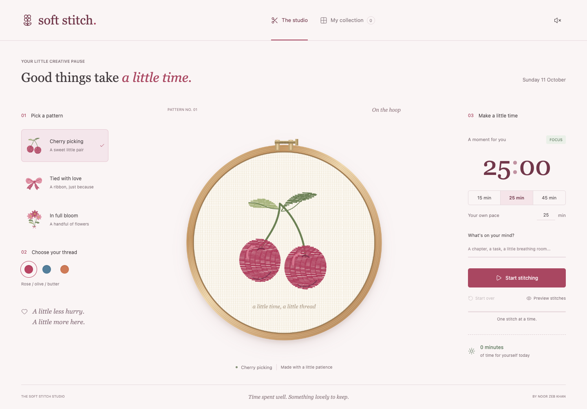

# Soft Stitch

A gentle embroidery focus timer by [Noor Zeb Khan](https://github.com/nfzkbh201). Pick a pattern, make a little time, and watch your session turn into a stitched keepsake.

[Open Soft Stitch](https://nfzkbh201.github.io/soft-stitch/)

## What it does

- Three stitch-by-stitch patterns: cherries, a ribbon bow, and a bouquet.
- Rose, cornflower, and peach thread palettes.
- Custom focus sessions, pause/resume, and recovery after a refresh.
- A short animation preview that does not count as a focus session.
- A personal collection of finished embroideries and downloadable PNG keepsakes.
- Optional completion sound, reduced-motion support, and responsive layouts.

Built with HTML, CSS, vanilla JavaScript, and the Canvas 2D API. No frameworks or paid services are required.

## Start

Open `dist/index.html` in a browser. No install, account, API key, or build step is needed. All scripts and icons are local.

Choose cherries, a bow, or flowers, select a thread palette, and set a focus session from 1 to 180 minutes. Preview stitches plays a short sample without starting or saving a focus session. Start, pause, resume, and reset work independently of the preview.

The needle follows actual individual stitch segments drawn on a textured fabric canvas. The timer uses a saved deadline, so refreshing or temporarily leaving the tab does not lose elapsed time. A session completes when the tab next runs if the browser was sleeping or closed. It cannot play its optional chime while the browser is closed.

Finished pieces and session notes are saved in the current browser's local storage, with a maximum of 365 pieces. They can be downloaded as PNGs or removed individually. Storage is not synced across devices or between a local file and the hosted site. Clearing browser data removes the collection. There are no analytics or remote font/image requests.

## Files

- `dist/index.html`: the studio and collection views.
- `dist/style.css`: responsive blush, rose, and sage styling.
- `dist/timer.js`: deadline-based timer state and validation.
- `dist/embroidery.js`: deterministic stitch patterns, fabric, and hoop rendering.
- `dist/app.js`: controls, persistence, collection, PNG export, and optional chime.
- `dist/assets/`: favicon and vendored Lucide icons, with their license.

## Verification

Run `node --test tests/timer.test.cjs` for timer state checks. Browser QA covers pattern selection, pause/resume, reload recovery, completion, collection, download, and mobile layout.

## Deployment

GitHub Actions runs the timer tests and JavaScript syntax checks, then publishes `dist/` to GitHub Pages on pushes to `main`. The repository's Pages source is **GitHub Actions**.

## What's next

The next version should make focusing feel like a small creative ritual:

1. **More tactile stitching:** a needle that enters and exits the cloth, thread that pulls taut, and stitches that follow the direction of each petal or ribbon fold.
2. **A compact desktop companion:** a small hoop and timer that can stay beside your work. Keep pause, remaining time, and sound within easy reach.
3. **A patchwork calendar:** arrange completed pieces by day and show weekly focus time without punishing missed days.
4. **Personal patterns:** embroidered initials, birth flowers, and a few well-drawn seasonal designs.
5. **Gentle session flow:** optional break timers, a clear completion notification, and collection backup/import.

Before building the next set of features, use it for a few real sessions and ask a handful of friends to try it. Find out whether the animation is calming, whether the timer is easy to keep visible, and whether they want to keep their finished pieces.

## Credits

Inspired by the playful utility of [Nashallery's Study Soda](https://nashallery.com/). The embroidery patterns, canvas rendering, and interface were created for this project. Icons are from [Lucide](https://lucide.dev/); the vendored license is included in `dist/assets/lucide-LICENSE`.
